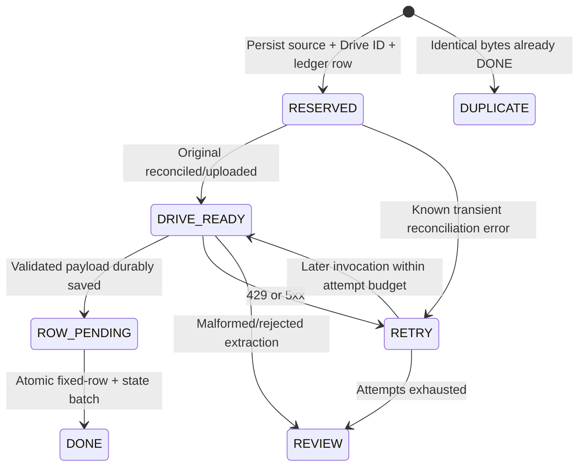

# Pilot architecture and persistence contract

Runtime: Apps Script V8 inside the authorized customer's Google account. GitHub holds source and synthetic tests only. Gemini Developer API receives selected document bytes for extraction; it is an external Google API with its own billing/data terms, not simply local Workspace processing.

```mermaid
flowchart LR
  A[Message with explicit pilot label] --> B[Read-only Gmail API]
  B --> C[Script lock and installation validation]
  C --> D[Durable attachment reservation]
  D --> E[Preallocated Drive file ID]
  E --> F[Reconcile or upload original]
  F --> G[Gemini extraction and deterministic validation]
  G --> H[Persist fixed-row payload]
  H --> I[Atomic shipment row plus DONE state]
  I --> J[Human review before accounting]
```

The customer creates a dedicated empty workbook and folder. Initialization binds the script ID, effective Gmail account, tenant slug, workbook, tab and folder by SHA-256 fingerprint in workbook, Script Properties, and folder properties. Runs refuse binding changes. Scope approval is separate from resource binding. One project/installer per customer is required; initialization across multiple projects is a supervised provisioning action, not a distributed atomic tenant registry.

## Attachment identity and deduplication

Attachment key = SHA-256(JSON([tenant ID, immutable Gmail message ID, MIME part ID, attachment ID (or inline part ID), SHA-256(bytes)])). Final source identities skip repeat downloads because Gmail message payloads are immutable. Names/read state are not identities. Supported attachments are independent documents, not multi-photo aggregation. MIME parts without filenames are skipped.

Identical bytes elsewhere in this installation produce a separate `DUPLICATE` journal record referencing the canonical key/file but no new shipment or upload. This intentionally treats byte-identical resubmissions as the same document. Different encodings/scans or multi-page photos do not deduplicate semantically. All original message/part/attachment references remain in the journal; Gmail originals are retained. If canonical processing is unresolved, same-content messages wait. A source placed in REVIEW requires operator reconciliation; copies do not bypass its hold.

## Durable journal and recovery

`_WayBillrProcessing`: two columns, attachment key and bounded JSON record. JSON contains installation binding, immutable source IDs, content hash, MIME, reserved Drive ID, fixed ledger row, state-row coordinate, creation time, attempt count, retry time, state/code, and (after extraction) the exact 24-cell payload. Duplicate records add `duplicateOf`. This is sensitive customer data kept in Google Sheets, never GitHub. Reserved duplicate rows may leave harmless gaps in `Shipments`.

`LockService.getScriptLock` excludes overlapping invocations of this project. A busy lock causes a no-write skip. It does not coordinate a different project or a human editing rows: do not share the workbook with another ingestion project, sort/insert/delete shipment rows, edit journal/binding tabs, or edit an in-flight reserved row. Use filter views or a separate reporting tab. Record accounting decisions in a separate workflow until ingestion is stopped. Protect these tabs against ordinary editors.

Drive IDs come from `files.generateIds` and are persisted **before** upload. Recovery gets that exact ID; only a recognized not-found response permits creation using the same ID. Existing files must match the key/hash metadata, parent, size and non-trashed state. Unknown get outcomes or conflicts do not authorize an alternate upload. Google documents duplicate prevention for pre-generated IDs in [Drive upload guidance](https://developers.google.com/workspace/drive/api/guides/manage-uploads#use_a_pre-generated_id_to_upload_files). An ambiguous create stops; a later run reconciles the reserved ID. No filename search, upload-with-new-ID retry, conversion, deletion, or overwrite is used.

Sheets state reservations use fixed coordinates allocated from in-memory durable records rather than cached last-row reads after API writes. After extraction, ROW_PENDING and its full payload are persisted first. Final writes use one [atomic Sheets batchUpdate](https://developers.google.com/workspace/sheets/api/reference/rest/v4/spreadsheets/batchUpdate) for the reserved shipment row and DONE journal record. Before replay, the authoritative Values API must show that row empty or exactly equal to its stored payload; conflicting values stop. No append replay occurs. A lost final response is safe because the next invocation sees DONE or retries the same cells. User text is written as `stringValue`, never interpreted as a formula. Atomicity assumes the documented Google API contract; mocks test application recovery, not Google's runtime.

## Bounds and failure behavior

Each invocation scans at most the configured Gmail message page and processes at most the attachment operation limit. The soft deadline is checked before messages and attachments; a provider call already in flight cannot be interrupted. Immutable final records skip download/API work. The persistent `WB_PAGE_TOKEN` advances only on a completed page; stopping mid-page revisits it and skips final records. Once all pages finish, the next invocation starts at the beginning, including failed records eligible for retry. Gmail pagination can change as labels/messages change; keep the selection stable during qualification. A stale token fails closed; the operator can remove only that cursor after stopping processing.

429/5xx extraction results and known unknown Drive reconciliation outcomes defer retry by 2, 4, 8... minutes (capped at one hour) and at most the configured attempt budget. No in-run retry burst. Generic provider/transport exceptions stop the invocation without exposing the exception text; next invocation reconciles durable state. Attempt counters are persisted before provider work, so uncertain calls consume the budget. ROW_PENDING retries never re-extract and can reconcile after the extraction attempt budget is exhausted. 4xx rejection, malformed/truncated JSON, invalid types, or archive conflict is REVIEW, retaining the source. No failure row is fabricated in the shipment ledger.

## Cutover, compatibility and rollback

The 24 field positions remain unchanged, including duplicate date positions; all pilot rows require review and missing values remain empty. Journal/binding tabs are additive. This package supports a **fresh pilot**, not mixed baseline/pilot ingestion or automatic historical migration. Stop old triggers, use a new folder/workbook/project, label only selected documents, and establish manual acceptance. Retain legacy sheets unchanged. Disable/rollback retains data and journal; restoring the old automatic-reply code is unsafe. See the installation guide.
